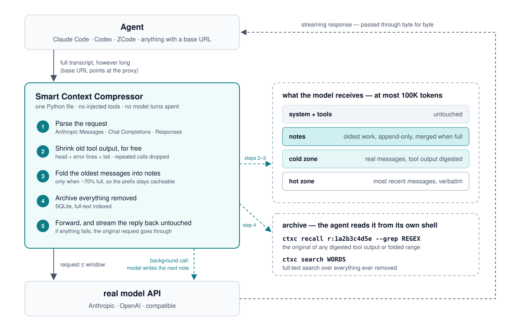

# Smart Context Compressor

## What it does

AI coding agents (Claude Code, Codex, ZCode and others) send the whole
conversation to the model on every turn. In a long session that conversation
keeps growing until it no longer fits in the model's context window. The agent
then either stops, or throws away most of its history in one lossy step and
forgets what it was doing.

Smart Context Compressor (command: `ctxc`) is a small program that runs on your
machine between the agent and the model. Each time the agent sends its
conversation, it shrinks it to fit a fixed budget (100K tokens by default)
before passing it on:

- **Recent work is left exactly as it is**, so the model sees what it is doing now.
- **Old tool output is trimmed**: long logs, test runs and file dumps are cut to
  their beginning, their error lines and their end.
- **The oldest part of the conversation is replaced by notes**: what you asked
  for, what was decided and why, what changed in each file, exact values worth
  keeping, and what is still unfinished.
- **Nothing is deleted**: everything removed is saved to a local database, and
  the agent can look up the original whenever it needs the exact detail.

The result is that a session can run for weeks without hitting the limit, and
each request costs far less than sending the full history would.

## Why this one

- One Python file, standard library only. No Node, no build, no certificates.
- Works at the HTTP level, so it is agent-agnostic: Anthropic Messages,
  OpenAI Chat Completions and OpenAI Responses.
- The model never spends a turn on compression. Responses stream back untouched.
- Prompt caching keeps working, because the compressed conversation only changes
  when it has to.

> **Status:** early prototype. It passes its own tests against a simulated model
> API but has not yet been run with a real agent. See [Limits](#limits--read-before-relying-on-it).

## Quick start

```sh
python3 ctxc.py link                 # puts a `ctxc` launcher in ~/.local/bin
ctxc serve --window 100000           # listens on 127.0.0.1:8787
```

Then point the agent at it:

| Agent | Setting |
|---|---|
| Claude Code | `ANTHROPIC_BASE_URL=http://127.0.0.1:8787 claude` |
| Codex CLI | a model provider with `base_url = "http://127.0.0.1:8787/v1"` and `wire_api = "responses"` |
| Anything OpenAI- or Anthropic-compatible (ZCode, aider, opencode, …) | base URL `http://127.0.0.1:8787` |
| Any other upstream (Z.ai, OpenRouter, a relay…) | base URL `http://127.0.0.1:8787/-/https/<host>/<path>` |

Default upstreams are `api.anthropic.com` and `api.openai.com`; change them with
`--anthropic-upstream` / `--openai-upstream`. Your API key or login token passes
through in the request headers and is never stored.

## How it works



Each request is rebuilt as four zones:

```
[ system + tools ]   untouched
[ summaries ]        append-only notes that replace the oldest messages
[ cold zone ]        real messages; tool output digested, repeated calls deduplicated,
                     large call arguments (file writes, patches) shortened
[ hot zone ]         the most recent messages, verbatim
```

1. **Free, model-less savings first.** Tool output is most of a coding session.
   Outside the hot zone each result is cut to head + error/warning lines + tail with
   original line numbers; a result whose identical call was repeated later is
   dropped; images are elided. This costs no model tokens.
2. **Folding.** When the view passes ~70% of the available room, the oldest cold
   messages are folded into a note and the view drops back to ~42%. The note is
   written by the model in a *background* side call started ahead of time. The
   summariser is given what a model compressing its own context would have:
   the earlier notes (so it records what changed, not what is already known),
   the slice with four times more of each tool output than the cold zone keeps,
   and the messages that came *after* the slice as hindsight on what mattered.
   It writes fixed sections: REQUIREMENTS (user's words), DECISIONS (with
   reasons), CHANGES (per file), FACTS (exact values, commands, errors and
   fixes) and OPEN. If the note is not ready at the epoch the request waits up
   to `--wait` seconds (default 20); after that, or with `--summarizer off`, a
   mechanical note with the same sections is used.
3. **Bounded forever.** When notes exceed ~16% of the room, the oldest four are
   merged into one, again by the model: requirements and decisions still in
   force are kept in their wording, only the final state of each file survives.
4. **Cache-friendly.** Rewriting happens only at these epochs. Between epochs the
   rewritten prefix is byte-identical from request to request, and notes are
   append-only, so provider prompt caching keeps working.
5. **Reversible.** Digests and notes carry references. The agent runs
   `ctxc recall r:1a2b3c4d5e --grep REGEX`, `ctxc recall s:12 --lines 40:90` or
   `ctxc search WORDS` in its normal shell tool. No injected tools, so no response
   rewriting.

Tool calls are never separated from their results, and a client rewind or edit of
history is detected (state that no longer matches is discarded).

## Measured (synthetic)

`python3 tests/sim.py 6000` replays a 6,000-tool-call session through the
compressor, one request per tool result, window 100K, mechanical notes only:

| wire | client transcript at the end | sent at the end | largest request | avg request | unchanged prefix | time per request |
|---|---|---|---|---|---|---|
| Anthropic Messages | 13.0M tokens | 39K | 70.9K | 53K | 98.9% | 9.7 ms |
| Chat Completions | 12.7M tokens | 44K | 70.3K | 51K | 99.1% | 8.6 ms |
| Responses | 12.9M tokens | 56K | 70.9K | 53K | 99.4% | 8.3 ms |

Sent raw, those 6,041 requests would total ~40B input tokens; through ctxc they
total 0.32B. "Unchanged prefix" is the share of sent tokens identical to the
previous request's prefix, i.e. the ceiling on prompt-cache hits, not a measured
hit rate. On every one of the requests the simulator also asserts that tool
calls and results stay paired and that the prefix does not change between epochs.

`python3 tests/test_ctxc.py` runs the test suite, including an end-to-end proxy
test (streaming, routing, background summaries) against a mock upstream.

`python3 tests/quality.py` plants 14 facts in a noisy 30K-token slice and reports
which survive folding. Without arguments it scores the mechanical note; with
`--url/--model/--header` it scores a note written by a real model (see the file).

## Limits — read before relying on it

- The client still holds and sends its full transcript; only what reaches the model
  shrinks. Late in a month-long session each request body is tens of MB over
  loopback. If the client compacts on its own, ctxc simply starts a new session
  for the compacted conversation; the archive stays searchable.
- Token counts are estimates (chars ÷ 3.5), deliberately conservative.
- `--summarizer auto` makes extra API calls on your key (one per fold, roughly
  every 30–40K tokens of new conversation). Use `off` for zero extra calls.
- Request bodies compressed with anything other than gzip are forwarded unchanged.
- Responses API requests that use `previous_response_id` are forwarded unchanged.
- The proxy has no authentication: keep it on 127.0.0.1.
- Archived tool output is stored unencrypted in `~/.ctxc/ctx.db`.
