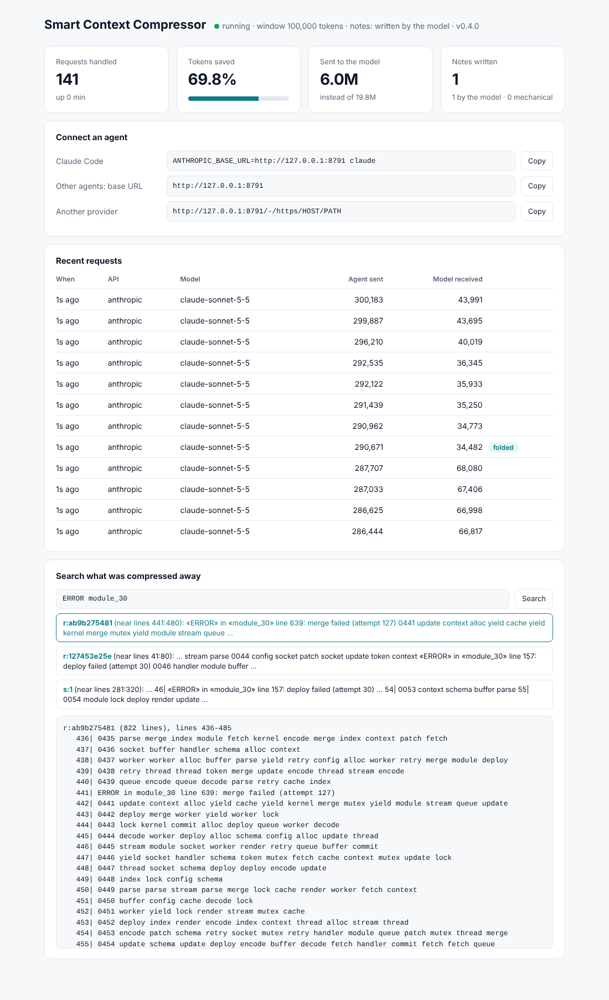

# Smart Context Compressor

**Run a coding agent for weeks in one session, inside a 100K-token window.**

*A small local proxy that compresses the conversation on its way to the model, and keeps every original.*

**One Python file · no dependencies · no injected tools · responses streamed back untouched**

   

`python3 ctxc.py serve` · then point your agent's base URL at `http://127.0.0.1:8787` · open the same address in a browser to watch it work

---

> In a 6,000-tool-call benchmark session (13M tokens of history), every request stays under **71K tokens** with **~99%** of it in an unchanged, cacheable prefix. Check your own numbers with `curl http://127.0.0.1:8787/__ctxc/stats`.

---

Smart Context Compressor (command: `ctxc`) sits between a coding agent and its model API. The agent keeps sending its full conversation; the proxy shrinks it to a fixed budget, forwards it, and streams the reply straight back.

## Why

AI coding agents send the whole conversation to the model on every turn. In a long session the conversation grows until it no longer fits in the model's context window. The agent then either stops, or throws away most of its history in one lossy step and **forgets what it was doing**.

Smart Context Compressor shrinks each request before it reaches the model:

- **Recent work is left exactly as it is**, so the model sees what it is doing now.
- **Old tool output is trimmed**: long logs, test runs and file dumps are cut to their beginning, their error lines and their end.
- **The oldest part of the conversation is replaced by notes**: what you asked for, what was decided and why, what changed in each file, exact values worth keeping, and what is still unfinished.
- **Nothing is deleted**: everything removed is saved to a local database, and the agent can look up the original whenever it needs the exact detail.

The model never spends a turn deciding what to compress, and **prompt caching keeps working** because the compressed conversation only changes when it has to.

## How it works


Each request is rebuilt as four zones:

```
[ system + tools ]   untouched
[ notes ]            append-only; they replace the oldest messages
[ cold zone ]        real messages; tool output digested, repeated calls dropped,
                     large call arguments (file writes, patches) shortened
[ hot zone ]         the most recent messages, verbatim
```

1. **Free savings first.** Outside the hot zone, each tool result is cut to head + error/warning lines + tail, with original line numbers. A result whose identical call was repeated later is dropped. Images are elided. This costs no model tokens.
2. **Folding.** When the request passes ~70% of the available room, the oldest cold messages are folded into a note and the request drops back to ~42%.
3. **Model-written notes.** The note is written by the model in a *background* call started ahead of time. The summariser sees the earlier notes, the slice with four times more of each tool output than the cold zone keeps, and the messages that came *after* the slice as hindsight. It writes fixed sections: REQUIREMENTS, DECISIONS, CHANGES, FACTS and OPEN.
4. **Bounded forever.** When notes exceed ~16% of the room, the oldest four are merged into one. Requirements and decisions still in force keep their wording; only the final state of each file survives.
5. **Cache-friendly.** Rewriting happens only at these moments. In between, the rewritten prefix is byte-identical from request to request.

Tool calls are never separated from their results. If the client rewinds or edits history, state that no longer matches is discarded.

### Recall commands

The agent runs these in its normal shell tool. Every digest and note carries the reference to use.

- **`ctxc recall r:1a2b3c4d5e`** — the original of a digested tool output. Add `--grep REGEX` or `--lines A:B` to pull only the part needed.
- **`ctxc recall s:12`** — the transcript behind a note, with the same `--grep` and `--lines` options.
- **`ctxc search WORDS`** — full-text search over everything ever removed.
- **`ctxc stats`** — size of the archive.

## Which do I need?

| Client | Use |
|---|---|
| Claude Code | Option 1: `ANTHROPIC_BASE_URL=http://127.0.0.1:8787` |
| Codex CLI | Option 1: a model provider with `base_url = "http://127.0.0.1:8787/v1"` and `wire_api = "responses"` |
| aider, opencode and other OpenAI- or Anthropic-compatible clients | Option 1: base URL `http://127.0.0.1:8787` |
| ZCode, or any client talking to Z.ai, OpenRouter or a relay | Option 2: the `/-/` upstream prefix |
| Cursor | Probably not supported locally: its requests appear to go through Cursor's own servers, which cannot reach `127.0.0.1` (unverified) |

The Codex and ZCode rows follow those clients' documentation; if a setting differs in your version, please open an issue.

## Install

```sh
git clone https://github.com/8dkj4fjrrs-cmyk/Smart-Compressor-.git
cd Smart-Compressor-
python3 ctxc.py link        # puts a `ctxc` launcher in ~/.local/bin
```

Needs Python 3.9 or newer (developed on 3.13) with SQLite, which ships with Python. Nothing to `pip install`.

## Quickstart

- **Option 1 — Base URL.** For clients that talk to Anthropic or OpenAI directly.
- **Option 2 — Upstream prefix.** For any other provider.

### Option 1 — Base URL

```sh
ctxc serve --window 100000                        # terminal 1
ANTHROPIC_BASE_URL=http://127.0.0.1:8787 claude   # terminal 2
```

- Requests to `/v1/messages` go to `api.anthropic.com`; `/v1/chat/completions` and `/v1/responses` go to `api.openai.com`.
- Change the defaults with `--anthropic-upstream` and `--openai-upstream`.
- Your API key or login token passes through in the request headers and is never stored.

### Option 2 — Upstream prefix (`/-/`)

Put the real host after `/-/https/`:

```
before:  https://api.example.com/api/coding/v1
after:   http://127.0.0.1:8787/-/https/api.example.com/api/coding/v1
```

Verify that the proxy is seeing traffic:

```sh
curl http://127.0.0.1:8787/__ctxc/stats
```

## From source (development)

> There is no build step. `ctxc.py` is the whole program.

```sh
python3 tests/test_ctxc.py     # test suite, including an end-to-end proxy test against a mock API
python3 tests/sim.py 6000      # replay a 6,000-tool-call session and print the table below
python3 tests/quality.py       # plant 14 facts in a noisy slice and count which survive folding
```

## 📊 Benchmarks

A generated 6,000-tool-call coding session, sent through the compressor one request at a time (`tests/sim.py`), window 100K, mechanical notes only:

| Wire | Client transcript at end | Sent at end | Largest request | Average request | Unchanged prefix | Time per request |
|---|---|---|---|---|---|---|
| Anthropic Messages | 13.0M tokens | 39K | 70.9K | 53K | 98.9% | 9.7 ms |
| Chat Completions | 12.7M tokens | 44K | 70.3K | 51K | 99.1% | 8.6 ms |
| Responses | 12.9M tokens | 56K | 70.9K | 53K | 99.4% | 8.3 ms |

Sent raw, those 6,041 requests would total ~40B input tokens; through the proxy they total 0.32B. "Unchanged prefix" is the ceiling on prompt-cache hits, not a measured hit rate. This table was measured before the note sizes were raised; a 1,500-step rerun afterwards gave the same peak and ~97.5% unchanged prefix.

On the fact-retention check (`tests/quality.py`), the mechanical fallback note keeps 10 of 14 planted facts at 49× compression.

## FAQ

**Does the model have to do anything?** No. Compression happens in the proxy. The model only reads the result, and may run `ctxc recall` or `ctxc search` when it wants an original.

**Does it make extra API calls?** Yes, by default: one background call per fold (roughly every 20–40K tokens of new conversation) so the model can write the note, on your key. `--summarizer off` makes none and uses mechanical notes.

**What if the proxy gets something wrong?** It fails open. If parsing or compression raises an error, the original request is forwarded unchanged and the error is logged.

**Can a request stall?** If a note is not ready when it is needed, the request waits up to `--wait` seconds (default 20) and then uses a mechanical note.

**Is anything lost?** Not from the archive. The model's view is lossy by design; the originals stay in `~/.ctxc/ctx.db`.

**Does my client still compact on its own?** It may. The proxy then treats the compacted conversation as a new session. The archive stays searchable.

**How are tokens counted?** Estimated as characters ÷ 3.5, which is deliberately conservative.

## Running the proxy

### Web page

Open `http://127.0.0.1:8787` in a browser while the proxy is running.



It is one read-only page: how much has been saved, the latest requests (what the agent sent and what the model received), the address to give your agent, and a search box over everything that was compressed away. There is nothing to configure, and it only answers on localhost.

### Flags

```sh
ctxc serve
  --port 8787                 # listen port
  --host 127.0.0.1            # listen address
  --window 100000             # most tokens the model should ever see
  --summarizer auto           # auto | off | a model name to write notes with
  --wait 20                   # max seconds a request waits for a note
  --anthropic-upstream URL    # default https://api.anthropic.com
  --openai-upstream URL       # default https://api.openai.com
  --verbose                   # log every request, not only folds
ctxc --dir PATH ...           # store location (default ~/.ctxc, or $CTXC_DIR)
```

### Debugging

Run with `--verbose` to log one line per request with tokens before and after. Lines marked `(epoch)` are the requests where folding happened.

### Storage

Everything is in one SQLite file, `~/.ctxc/ctx.db`. Archived tool output is stored compressed but **unencrypted**.

### Limits

- The client still holds and sends its full transcript; only what reaches the model shrinks. Late in a month-long session each request body is tens of MB over loopback.
- Request bodies compressed with anything other than gzip are forwarded unchanged.
- Responses API requests that use `previous_response_id` are forwarded unchanged.
- The proxy has no authentication: keep it on `127.0.0.1`.

## License

[MIT](LICENSE)
